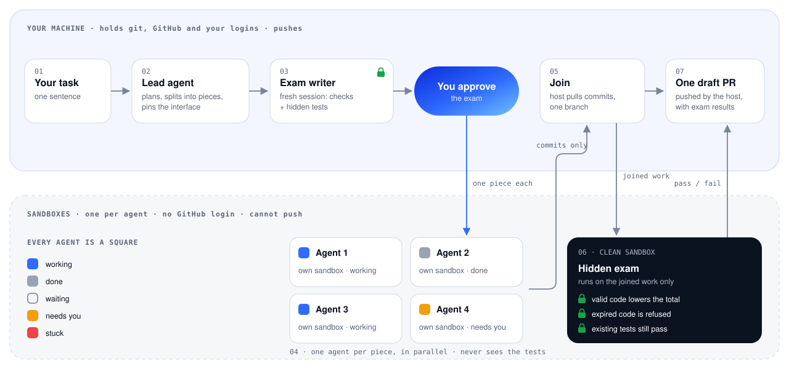

<p align="center">
  
</p>

<h1 align="center">TaskWing</h1>

<p align="center">
  <b>The open source harness for your coding agents.</b><br>
  TaskWing runs the coding agents you already use, many at once and each in its own sandbox.<br>
  It checks their joined work with a hidden exam and gives you one tested pull request.
</p>

<p align="center">
  <a href="https://github.com/josephgoksu/TaskWing/actions/workflows/ci.yml"></a>
  <a href="LICENSE"></a>
  <a href="go.mod"></a>
  
  
</p>

<p align="center">
  <a href="#install">Install</a> ·
  <a href="#quickstart">Quickstart</a> ·
  <a href="#the-harness">The harness</a> ·
  <a href="#status">Status</a> ·
  <a href="#contributing">Contributing</a> ·
  <a href="https://taskwing.app">taskwing.app</a>
</p>

<p align="center">
  
</p>

> **Early and moving fast.** The CLI runs real tasks today with Claude Code agents in [boat](https://boat.dev) sandboxes. More agent runtimes, models and sandbox providers are next. See [Status](#status) for exactly what works.

## How it works

```
           ┌───────────────────────── TaskWing orchestrates ─────────────────────────┐
 your task │  your agent plans  →  N agent sessions, one per sandbox  →  hidden exam │ → one tested PR
           └─────────────────────────────────────────────────────────────────────────┘
                      ↑ the agents are yours: Claude Code today, Codex or OpenCode next
```

| TaskWing | What that means for you |
|---|---|
| **Orchestrates your agents** | Your coding agent plans the task. TaskWing starts one agent session per piece, then checks and joins their work |
| **Runs on your machine** | One Go binary, using the agent logins and subscriptions you already have |
| **Plugs into your sandboxes** | boat today; E2B, Docker and AWS next |

## Why TaskWing

Running many coding agents is easy. What runs out is work that doesn't conflict, and your time to review it. TaskWing counts success in verified merges.

- **One task in, one pull request out.** Your own coding agent plans the task and splits it into pieces that share no files. One agent builds each piece, in parallel.
- **Every agent in its own sandbox.** No GitHub login inside a box. Agents commit locally; your machine pulls the commits, joins them and pushes.
- **A hidden exam.** Before any work starts, a fresh session writes the checks and the tests behind them. You approve the checks. The tests never reach the lead or any worker, so nobody can teach to them. They run in a clean sandbox on the joined work.
- **Your agent, your subscription.** The engine has no model code and no API key of its own. The lead is your own coding agent on your machine.
- **Plugs into what you have.** Bring your sandbox provider and your agent CLIs. TaskWing connects them through two small adapters, Box and Agent.

## Install

```bash
# macOS and Linux
brew install josephgoksu/tap/taskwing

# Anywhere with Go 1.24+
go install github.com/josephgoksu/TaskWing/v2/cmd/taskwing@latest
```

Linux packages (`.deb`, `.rpm`, `.apk`) and archives for macOS, Linux and Windows are on the [releases page](https://github.com/josephgoksu/TaskWing/releases).

**You also need:** `bash` and `git` on your PATH (every run goes through bash, Windows included), the [GitHub CLI](https://cli.github.com) (`gh`, logged in), [Claude Code](https://code.claude.com/docs) (`claude`, logged in) and, for sandboxes, the `boat` CLI.

## Quickstart

```bash
cd your-repo                     # a clean working tree

# 1. See the flow in two minutes, on your machine: no sandboxes, no isolation
taskwing run "add a /health endpoint with a test" --provider local --no-pr

# 2. The real thing: every agent in its own sandbox, one draft pull request
taskwing config boat-base bx_abc123      # one setting for every repo; per repo use --boat-base (docs/poc.md)
taskwing run "add discount codes at checkout, with tests"

# 3. Hunt bugs: each one proven by a failing test, then fixed in parallel
taskwing hunt "the payment code"
```

```
1/4 Plan    lead splits the task  ·  a separate session writes the hidden exam
            you read both, press y
2/4 Build   one sandbox and one agent per piece, live squares
3/4 Exam    pieces joined on one branch, exam runs in a clean sandbox
4/4 PR      pushed from your machine, draft pull request, sandboxes deleted
```

Every flag, the boat setup and what a run leaves behind: [docs/poc.md](docs/poc.md).

## The harness

<picture>
  <source media="(prefers-color-scheme: dark)" srcset="docs/assets/harness-dark.svg">
  
</picture>

| Rule | What breaks without it |
|---|---|
| One agent per piece, each in its own sandbox | Agents trip over each other's files and processes |
| The engine refuses a plan where two pieces own the same path | Merge conflicts that eat the time parallel work saved |
| A fresh session writes the exam before the work; its tests stay hidden | Agents edit tests until they pass, so "verified" means nothing |
| The exam runs in a clean sandbox on the joined work | A pass that depends on one agent's leftover state |
| No GitHub login in any sandbox; the host pushes | One compromised agent pushes to `main` |
| You approve the exam and you merge. TaskWing never merges | A misread task burns a run, or lands unreviewed |

The full set of rules, each with its reason: [PRINCIPLES.md](PRINCIPLES.md).

### Where it sits

```
┌ Control planes ─── GitHub Agent HQ, vendor cloud agents   (one task → one PR)
├ TaskWing ───────── one goal → N boxes → one verified PR   (headless, any vendor)
├ Agent interface ── ACP: Claude Code, Codex, Gemini CLI, Copilot CLI, ...
└ Sandboxes ──────── E2B, Daytona, Modal, Vercel, Cloudflare, Docker, any SSH host
```

### Architecture

One Go binary does all the work. By design the CLI and the desktop app are both thin clients of it, so anything the app can do can also be scripted.

| Part | What it does | What it never does |
|---|---|---|
| **Engine** (`internal/`, Go) | Runs, plan check, sandboxes, exam runner, git join, push, GitHub | Call a model itself |
| **CLI** (`cmd/taskwing`) | Every action, as a command | Anything the engine can't do |
| **Desktop app** (`app/`, Tauri) | Shows engine events as squares, sends commands | Hold logic or state of its own |
| **Lead and exam writer** | Your own coding agent, on your machine | See the hidden tests (lead) |
| **Workers** | Agent CLIs inside sandboxes, one piece each | Push, hold a GitHub login, see the exam |

Every concept and how they connect: [docs/ARCHITECTURE.md](docs/ARCHITECTURE.md).

## Status

✅ built · 🟡 partial · ⬜ planned. The full list of every feature is in [docs/FEATURES.md](docs/FEATURES.md).

| Area | Today | Next |
|---|---|---|
| **Run** | ✅ `taskwing run`, plan check, parallel agents, join, draft PR · ✅ `taskwing hunt` | ⬜ lead resolves join conflicts · ⬜ resume after a crash |
| **Exam** | ✅ fresh exam writer, hidden tests, clean exam sandbox · 🟡 approve before dispatch | ⬜ add your own check · ⬜ plain-words failure reports |
| **Sandboxes** | ✅ boat · ✅ local (no isolation, for trying it) | ⬜ E2B · ⬜ AWS · ⬜ Docker |
| **Agents and models** | ✅ Claude Code · 🟡 lead and exam writer on any command | ⬜ a second runtime (OpenCode or Codex) · ⬜ open-weight models · ⬜ per-step model routing |
| **Safety** | ✅ no GitHub login in any box · 🟡 refuse boxes with GitHub credentials · 🟡 secret scan before destroy | ⬜ key proxy · ⬜ hardened git reads of worker commits |
| **Clients** | ✅ CLI · 🟡 desktop app for macOS, Linux and Windows · ✅ engine event stream for the app (`taskwing engine --json`) | ⬜ start from a Claude Code skill |

## Desktop app

The app in [`app/`](app/) is a small [Tauri 2](https://tauri.app) shell with a plain HTML, CSS and JavaScript window. Every agent is a square: blue working, grey done, amber needs you, red stuck. It runs real tasks through `taskwing engine --json`, and falls back to a built-in demo engine when no `taskwing` is installed. Until the first app release, test builds are on the successful manual runs of the [Release desktop app workflow](https://github.com/josephgoksu/TaskWing/actions/workflows/release-app.yml?query=event%3Aworkflow_dispatch+branch%3Amain+is%3Asuccess) (GitHub sign-in needed, kept 90 days). On a Mac take `darwin-universal-dmg`; the builds are not notarised or signed yet, so macOS and Windows ask before the first launch. Or run it from source with `cd app && npm install && npm run dev` (see [app/README.md](app/README.md)).

## Contributing

TaskWing is early, so this is a good time to shape it. Good first areas:

- **A sandbox provider** (E2B, Docker, AWS). A provider needs only create, exec, start agent, list and destroy: see the `Provider` interface in [`internal/box`](internal/box).
- **A second agent runtime** (OpenCode, Codex CLI, Gemini CLI).
- **The missing app events**: pausing agents, agent questions and notes between agents ([app/docs/engine-protocol.md](app/docs/engine-protocol.md)).

Read [CONTRIBUTING.md](CONTRIBUTING.md) first; it has the checks CI runs and the few house rules. Found a security problem? See [SECURITY.md](SECURITY.md).

| Read | Why |
|---|---|
| [PRINCIPLES.md](PRINCIPLES.md) | The rules every feature is built on |
| [SPEC.md](SPEC.md) | Stages, engine interface, CLI and the first milestone |
| [docs/ARCHITECTURE.md](docs/ARCHITECTURE.md) | Every concept and how they connect |
| [docs/FEATURES.md](docs/FEATURES.md) | What is built and what is planned |
| [AGENTS.md](AGENTS.md) | Decisions so far, and how the repo is checked and released |

## Repository layout

```
cmd/taskwing/     the CLI entry point
internal/engine/  runs, plan check, exam, join, pull request
internal/box/     sandbox providers (boat, local)
app/              desktop app (Tauri shell in src-tauri/, UI in ui/)
docs/             architecture, features, PoC guide, diagrams
context/          research behind the principles
```

## License

[AGPL-3.0](LICENSE), with a [NOTICE](NOTICE). Copies must credit TaskWing and stay open, even when run as a hosted service. Earlier copies (up to v1.23.2 and the first v2-poc builds) keep their old licence; the v1 knowledge layer lives on at tag [`v1.23.2`](https://github.com/josephgoksu/TaskWing/tree/v1.23.2). Geist fonts in the app are under the SIL Open Font License.
