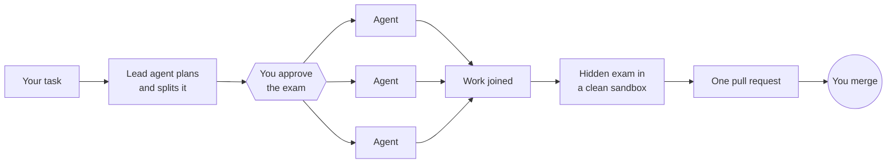
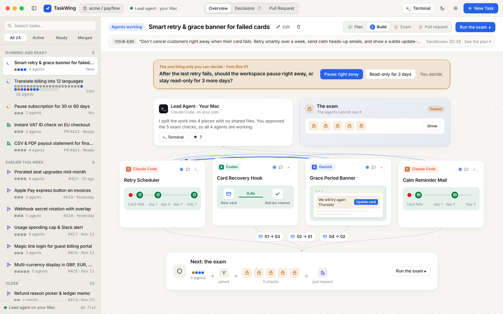

# TaskWing

One task in, one verified pull request out. Your own coding agent plans the task and splits it into pieces, many agents build the pieces in cloud sandboxes, a hidden exam checks the joined work in a clean sandbox, and you merge one pull request.





Version 2 is being built. Two pieces exist today:

| Piece | Where | State |
|---|---|---|
| Engine and CLI | `cmd/`, `internal/` (Go) | Proof of concept: `taskwing run`, `hunt`, `doctor`. See [docs/poc.md](docs/poc.md) |
| Desktop app | [`app/`](app/) (Tauri) | Built for Mac, Linux and Windows. Runs on its demo engine until the engine stream lands |

```bash
go install github.com/josephgoksu/TaskWing/cmd/taskwing@main
taskwing run "add an alert webhook with tests"
```

Desktop builds are on the [releases page](https://github.com/josephgoksu/TaskWing/releases). To run the app from source, see [app/README.md](app/README.md).

The v1 knowledge layer was removed; it stays available at tag `v1.23.2`.

| Read | Why |
|---|---|
| [PRINCIPLES.md](PRINCIPLES.md) | The rules every feature is built on |
| [SPEC.md](SPEC.md) | What v2 is made of and the first milestone |
| [docs/ARCHITECTURE.md](docs/ARCHITECTURE.md) | Every concept and how they connect |
| [docs/FEATURES.md](docs/FEATURES.md) | What is built and what is planned |
| [AGENTS.md](AGENTS.md) | Decisions so far |
| [app/AGENTS.md](app/AGENTS.md) | Rules for the desktop app |

Licence: AGPL-3.0 (see [LICENSE](LICENSE) and [NOTICE](NOTICE)). Earlier copies (up to v1.23.2 and the first v2-poc builds) keep their old licence. Geist fonts in the app are under the SIL Open Font License.
