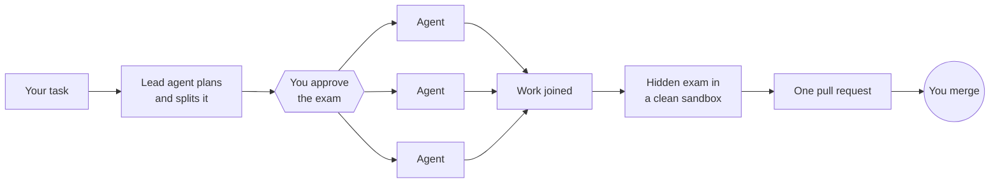

# TaskWing

One task in, one verified pull request out. Your own coding agent plans the task and splits it into pieces, many agents build the pieces in cloud sandboxes, a hidden exam checks the joined work in a clean sandbox, and you merge one pull request.

Version 2 is being designed. Nothing here runs yet. The v1 knowledge layer was removed; it stays available at tag `v1.23.2`.

| Read | Why |
|---|---|
| [PRINCIPLES.md](PRINCIPLES.md) | The rules every feature is built on |
| [SPEC.md](SPEC.md) | What v2 is made of and the first milestone |
| [AGENTS.md](AGENTS.md) | Decisions so far |
| [prototype/flight-deck/index.html](prototype/flight-deck/index.html) | What the desktop cockpit looks like (open from disk) |

MIT licence.
