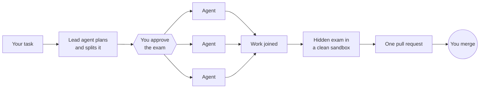

# TaskWing v2 spec

Draft, 2026-11-14, updated 2026-11-22. Built on `PRINCIPLES.md`; where the two disagree, the principles win until one of them is changed with its reason. TaskWing is one Go binary used from the terminal (decided 2026-11-22; the earlier desktop app stays in git history).

## What it does

The user gives one task for a repository. Their own coding agent (the lead) plans it and splits it into pieces with no shared files. A fresh agent session writes the exam: plain-sentence checks plus hidden tests. The user approves the exam. TaskWing starts one agent per piece, each in its own sandbox. When they finish, their work is joined, the exam runs in a clean sandbox, and the result is one draft pull request with proof. The user merges.



## Parts

| Part | What it is | What it does | What it never does |
|---|---|---|---|
| Engine | Go binary `taskwing`, AGPL-3.0 | Runs, state, box provider adapter, exam runner, git pull/join/push, GitHub. Planned: key proxy, separate agent adapter | Call a model itself (no model code, no API key of its own) |
| CLI | Same binary | Every action as a command; draws the run as one line per agent in the terminal | Hold logic the engine doesn't have (`PRINCIPLES.md` #11) |
| JSON stream | `taskwing engine --json` | The same runs for scripts, CI and editors (`docs/engine-protocol.md`) | Run hunts (CLI only for now) |
| Lead | The user's own agent CLI, run headless on the host per run: `TASKWING_LEAD_CMD`, default `claude -p` with read-only tools. Planned: start from a TaskWing skill | Reads the task and repo, writes the plan. Planned: answers workers, resolves conflicts at join | See the exam tests |
| Exam writer | A fresh headless agent session on the host, started per run (`TASKWING_EXAM_CMD`) | Writes the checks and the tests from the task, the repo and the pinned interface only. Planned: explains failures in plain words | See the plan's prompts or any worker's output before the exam runs |
| Workers | Agent CLIs inside sandboxes: Claude Code today; Codex, OpenCode, Gemini planned | Build one piece, commit locally | Hold a real secret, push, see the exam |
| Sandboxes | boat first; local folders for trying it (no isolation); Docker planned; never our own | Run workers and the exam | |

## Stages

| # | Stage | Who acts | Ends when | What breaks without the gate |
|---|---|---|---|---|
| 1 | Plan | Lead writes the plan; engine checks the split; exam writer writes the exam | The user approves (`y`), after any checks of their own or new plans (`r`) | A misread task burns a run before anyone sees it |
| 2 | Build | Engine creates boxes and starts one agent per card | Every card is done, or the user asks for the exam now (`e`) | |
| 3 | Exam | Engine pulls commits to the host, joins them on one branch, runs the tests in a clean box | Every check has passed or failed. Planned: a ruling for each failure | A pass that depends on one worker's leftover state |
| 4 | Pull request | Engine pushes from the host and opens a draft PR with proof and exam results | The user merges or closes it | Unreviewable output |

A card whose work conflicts with the others at join is left out and shown as stuck (planned: the lead resolves the conflict). Planned after the PR opens: trusted feedback (CI failures, reviews from users GitHub confirms can write, exact bot logins) goes back to the worker that owns the files. TaskWing never merges.

## Plan file (written by the lead)

`~/.taskwing/runs/<id>/plan.json`, fields as in `internal/engine/plan.go`:

```json
{
  "task": "Retry failed card payments for a week",
  "interface": "POST /payments/{id}/retry returns 202\nenv RETRY_DAYS",
  "cards": [
    {
      "id": "c1",
      "title": "Retry scheduler",
      "owns": ["billing/retry/**"],
      "prompt": "..."
    }
  ],
  "seams": [{ "between": ["c1", "c2"], "owner": "c1", "contract": "retry date in UTC" }]
}
```

| Object | Fields |
|---|---|
| Plan | `task`, `interface` (optional; a list or object is flattened to lines), `cards`, `seams` (optional) |
| Card | `id`, `title`, `owns`, `prompt`; in hunt mode also `where` and `why` |
| Seam | `between` (two card ids), `contract`, `owner` |

The plan check refuses:

| Refused | What breaks without it |
|---|---|
| Two cards whose paths overlap, compared without case, with `**` patterns checked against folders | Merge conflicts that eat the time parallel work saved |
| A pattern with a leading `/` or `./` is normalised first; one with `..`, or one that is the whole repo, is refused | A card that owns everything, or a path outside the repo |
| Two card ids that differ only in case, or an id that can't name a branch | Two agents write the same branch or log file |
| A seam that doesn't name two known cards, or whose owner isn't one of them | A contract nobody is responsible for |
| A card that owns a path containing `taskwing_exam` | A worker writes over the hidden exam |

## Exam files (host only, never copied into a worker's box)

| File | What |
|---|---|
| `~/.taskwing/runs/<id>/exam/checks.json` | One plain sentence per check, with the command that runs it. Shown to the user, visible to the lead. A check the user typed is marked `user` |
| `~/.taskwing/runs/<id>/exam/exam.patch` | The tests behind the checks. Only the exam box gets it |

`plan.json` is saved only after the exam is written, and a new plan (`r`) deletes the old exam first, so neither the lead nor the exam writer reads the other's output.

## Engine interface

The engine speaks newline-delimited JSON: events out, commands in. The CLI's board and `taskwing engine --json` show the same run. What is built, field by field: [docs/engine-protocol.md](docs/engine-protocol.md).

## State on disk

| Path | What | Owner |
|---|---|---|
| `~/.taskwing/` (moved by `TASKWING_HOME`) | Config, runs, repo cache, local boxes | Engine |
| `~/.taskwing/config.json` | `boat_base` | `taskwing config` |
| `~/.taskwing/runs/<id>/events.jsonl` | Append-only log. Planned: every dispatch written before it is sent (#6) | Engine |
| `~/.taskwing/runs/<id>/plan.json` | The plan as approved | Lead, then frozen |
| `~/.taskwing/runs/<id>/exam/` | Checks and tests | Exam writer, then user |

A run id is `tw-YYYYMMDD-HHMMSS-xxxx` (4 hex). Planned: on start the engine rebuilds every run from the provider's box list, git refs, GitHub and the event log (#4).

## CLI

| Command | Does | Status |
|---|---|---|
| `taskwing run "<task>" [flags]` | Plan, exam, build, join, exam, pull request | built |
| `taskwing hunt ["<area>"] [flags]` | Find bugs, prove each with a failing test, fix them | built |
| `taskwing config [boat-base <id>]` | Shows or saves the boat base box | built |
| `taskwing doctor [--provider boat\|local] [--clean]` | Finds (and deletes) leftover boxes and agent refs, never the base | built |
| `taskwing engine --json [--max-cards n] [--keep]` | JSON lines on stdin and stdout | built |
| `taskwing version`, `taskwing help` | Version (the tag, the module version, or `dev`); usage | built |
| `taskwing status [run]` | One line per agent | planned |
| `taskwing answer <question> <option>` | Answers the one open question | planned |
| `taskwing attach <NN>` | Opens one worker's session | planned |
| `taskwing stop [run]` | Stops every box of a run | planned |
| `taskwing setup` | Makes the base for a repository | planned |

Run flags, environment variables and exit codes: `docs/guide.md`. Before planning, `run` and `hunt` check that the boat CLI exists and a base box is set, so a first run doesn't spend tokens and then fail.

## Terminal board

| Rule | What breaks without it |
|---|---|
| Four numbered steps in order: 1/4 Plan (or Hunt), 2/4 Build, 3/4 Exam, 4/4 Pull request | The user can't tell how far the run is |
| Pictures over sentences: one line per agent, a glyph and a short proof line. ■ grey done, ▣ blue working, □ waiting, ✗ red stuck. Planned: amber "needs you", once agents can ask questions | The user reads a log to learn what one line says |
| It asks only what only the user can decide: the exam and the pull request. One question at a time. At the plan: `y` start, `n` stop, `r` new plan, or a sentence to add a check. During the build: `e` + Enter runs the exam now | A queue of prompts nobody answers |
| On a terminal the board redraws in place; piped or in CI it prints one line per state change, and `NO_COLOR` turns colour off | Escape codes in CI logs, or a scrollback flood on a terminal |
| Planned: above one screen of agents only a summary line stays; `taskwing status` lists the rest | Lines stop being readable past a screen |

## Logins and keys

| What | Where it lives |
|---|---|
| Lead and exam writer login | The user's own agent on their machine. TaskWing never sees it |
| Worker subscription login (Claude, ChatGPT) | The sandbox provider (boat). TaskWing never holds it |
| Worker API keys | Planned: TaskWing's proxy outside the box; the box gets a placeholder and a base URL |
| GitHub | The host's `gh`. Never in a box. Local mode strips GitHub and SSH tokens from the agents' environment, but is still not a sandbox |

## First milestone (M1)

CLI only, boat only, Claude Code workers, 2 to 4 cards.

| Done when | Proof |
|---|---|
| One real task on one of Joseph's repos goes from `taskwing run` to a draft PR | The PR link |
| No real secret was in any box | A scan of every box's environment and home before destroy |
| Killing the engine mid-run and starting it again resumes the run | Same PR, no duplicate boxes |
| `taskwing doctor` after the run finds nothing left | Its output |

## Not verified yet

| Item | Needed for |
|---|---|
| boat exposes a preview port per box | Page proof pictures |
| The exam's tests can be kept out of a worker's reach on each provider | Principle 12 on providers other than boat |
| herdr over SSH works as the agent runtime in a box | Replacing per-provider agent quirks |
| Exam writer as `claude -p` stays inside plan limits next to the lead | Cost of the exam step |

## Not in v2.0

A sandbox of our own. A hosted service. A desktop app. A phone app (push pings only). Several attempts per card. Merging for the user.
