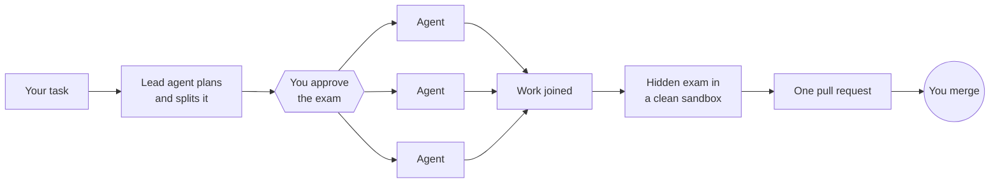

# TaskWing v2 spec

Draft, 2026-11-14. Built on `PRINCIPLES.md`; where the two disagree, the principles win until one of them is changed with its reason. The look is the TaskWing website's design system; the desktop app is in `app/`.

## What it does

The user gives one task for a repository. Their own coding agent (the lead) plans it and splits it into pieces with no shared files. A fresh agent session writes the exam: plain-sentence checks plus hidden tests. The user approves the exam. TaskWing starts one agent per piece, each in its own cloud sandbox. When they finish, their work is joined, the exam runs in a clean sandbox, and the result is one draft pull request with proof. The user merges.



## Parts

| Part | What it is | What it does | What it never does |
|---|---|---|---|
| Engine | Go binary `taskwing`, AGPL-3.0 | Runs, state, Box and Agent adapters, key proxy, exam runner, git pull/combine/push, GitHub | Call a model itself (no model code, no API key of its own) |
| CLI | Same binary | Every action the cockpit has, as a command | Anything the cockpit can't show |
| Cockpit | Tauri app in `app/`, engine bundled as a sidecar, the website's design system | Shows engine events, sends engine commands | Hold logic or state of its own (`PRINCIPLES.md` #11) |
| Lead | The user's own Claude Code in tmux session `taskwing`, with the TaskWing skill | Reads the task and repo, writes `plan.json`, answers workers, resolves conflicts at combine | See the exam tests |
| Exam session | A fresh headless agent session on the user's machine, started by the engine per run | Writes `exam.json` and the tests from the task and the repo only; explains failures in plain words | See the plan's prompts or any worker's output before the exam runs |
| Workers | Agent CLIs (Claude Code, Codex, Gemini, ...) inside sandboxes | Build one piece, commit locally, pass notes | Hold a real secret, push, see the exam |
| Sandboxes | boat first, local Docker second, never our own | Run workers and the exam | |

## Stages

| # | Stage | Who acts | Ends when | What breaks without the gate |
|---|---|---|---|---|
| 1 | Plan | Lead writes `plan.json`; exam session writes the exam; engine checks the split | The user approves the exam (or adds checks, then approves) | A misread task burns a run before anyone sees it |
| 2 | Build | Engine creates boxes and dispatches cards; workers build and pass notes | Every card is done, or the user says "run the exam now" | |
| 3 | Exam | Engine pulls commits to the host, joins them on one branch (lead resolves conflicts), runs the tests in a clean box | All checks pass, or each failure has a ruling | A pass that depends on one worker's leftover state |
| 4 | Pull request | Engine pushes from the host and opens a draft PR with before/after proof and exam results, then watches it | The user merges or closes it | Unreviewable output; feedback that never reaches a worker |

After the PR opens, trusted feedback (CI failures, reviews from users GitHub confirms can write, exact bot logins) goes back to the worker that owns the files. TaskWing never merges.

## Plan file (written by the lead)

```json
{
  "task": "Retry failed card payments for a week",
  "cards": [
    {
      "id": "c1",
      "title": "Retry scheduler",
      "agent": "claude",
      "owns": ["billing/retry/**"],
      "prompt": "...",
      "watch": { "kind": "test", "target": "go test ./billing/retry/..." }
    }
  ],
  "seams": [{ "between": ["c1", "c2"], "owner": "c1", "contract": "retry date in UTC" }]
}
```

The engine refuses a plan where two cards own the same path, a seam has no owner, or a card has no `watch`. `watch.kind` is `page`, `request`, `test` or `file`; it picks the picture on the card's proof (a page, a request, a timeline, a file).

## Exam file (host only, never copied into a worker's box)

| Field | Meaning |
|---|---|
| `checks[]` | One plain sentence each. Shown to the user, visible to the lead |
| `tests/` | The code behind the checks. Only the exam box gets it |
| `added_by` | `exam` or `user`. A user's check turns into a test by the exam session |

After approval only the user can change a check. Every change is logged in Decisions.

## Engine interface

The engine speaks newline-delimited JSON: events out, commands in. The CLI and the cockpit use the same stream.

| Events | Commands |
|---|---|
| `run.created`, `plan.ready`, `plan.refused` | `run.start {task, repo}` |
| `exam.ready`, `exam.approved` | `exam.approve`, `exam.add_check {text}` |
| `box.state {box, state}` | `box.restart`, `box.stop` |
| `agent.update {box, proof, thought}` | `agent.say {box, text}` |
| `agent.question {box, question, options}` | `question.answer {id, option or "you decide"}` |
| `note.passed {from, to, summary}` | |
| `decision.logged {kind, text}` | `decision.change {id, text}`, `decision.undo {id}` |
| `exam.check {n, passed, why}` | `exam.rule {n, "work" or "exam"}` |
| `pr.opened {url}`, `run.done` | `run.stop` |

Box states map to the cockpit's squares: `done` grey, `working` blue, `waiting` outline, `needs` amber, `stuck` red.

## State on disk

| Path | What | Owner |
|---|---|---|
| `~/.taskwing/runs/<id>/events.jsonl` | Append-only log; every dispatch is written here before it is sent (#6) | Engine |
| `~/.taskwing/runs/<id>/plan.json` | The plan as approved | Lead, then frozen |
| `~/.taskwing/runs/<id>/exam/` | Checks and tests | Exam session, then user |

On start the engine rebuilds every run from the provider's box list, git refs, GitHub and the event log (#4). Nothing else is trusted.

## CLI

| Command | Does |
|---|---|
| `taskwing init` | Checks tools and logins, names the default sandbox provider |
| `taskwing run "<task>"` | Starts a run; the lead plans it |
| `taskwing status [run]` | One line per agent, same states as the squares |
| `taskwing exam [run]` | Shows the checks; `--approve`, `--add "<text>"` |
| `taskwing answer <question> <option>` | Answers the one open question |
| `taskwing attach <NN>` | Opens one worker's session |
| `taskwing stop [run]` | Stops every box of a run |
| `taskwing doctor` | Finds leaked boxes, stale branches, missing logins |
| `taskwing plan submit <file>` | Used by the lead skill; not for people |

## Cockpit

| Rule | What breaks without it |
|---|---|
| Views: Overview, Decisions, Pull Request. Stages: Plan > Build > Exam > Pull request. Memories live in each agent's panel; notes show as arrows between agents | Every extra tab is one more place to look |
| Pictures over sentences: an agent is a square, a check is a lock that turns green, a note is an arrow, a decision is an icon. Words only where the user decides or reads a decision | The user reads paragraphs to learn what one icon says |
| The agent decides and says so afterwards in Decisions (Decided, Fixed, Planned, You, Done), each with Change and Undo | The user manages the run instead of the agents |
| It asks only what only the user can decide: the exam, product questions, the merge. One question card at a time | A queue of prompts nobody answers |
| Each agent card shows its proof as a picture, never file names or code. The sentence is on hover | The user has to read code to know where things are |
| Above 8 agents the cards collapse into one square per agent; a square opens that agent | Cards stop being readable past a screen |
| The task list shows one square per agent on every task | The user opens each task to see progress |
| Desktop only, native Mac look, plain words | |

## Logins and keys

| What | Where it lives |
|---|---|
| Lead and exam session login | The user's own agent on their machine. TaskWing never sees it |
| Worker subscription login (Claude, ChatGPT) | The sandbox provider (boat). TaskWing never holds it |
| Worker API keys | TaskWing's proxy outside the box; the box gets a placeholder and a base URL |
| GitHub | The host's `gh`. Never in a box |

## First milestone (M1)

CLI only, boat only, Claude Code workers, 2 to 4 cards.

| Done when | Proof |
|---|---|
| One real task on one of Joseph's repos goes from `taskwing run` to a draft PR | The PR link |
| No real secret was in any box | A scan of every box's environment and home before destroy |
| Killing the engine mid-run and starting it again resumes the run | Same PR, no duplicate boxes |
| `taskwing doctor` after the run finds nothing left | Its output |

The cockpit comes after M1 and reads the same event stream.

## Not verified yet

| Item | Needed for |
|---|---|
| boat exposes a preview port per box | Page proof pictures |
| tmux can be mirrored into a Tauri view without lag | Terminal tab in the cockpit |
| The exam's tests can be kept out of a worker's reach on each provider | Principle 12 on providers other than boat |
| herdr over SSH works as the agent runtime in a box | Replacing per-provider agent quirks |
| Exam session as `claude -p` stays inside plan limits next to the lead | Cost of the exam step |

## Not in v2.0

A sandbox of our own. A hosted service. A phone app (push pings only). Several attempts per card. Merging for the user.
