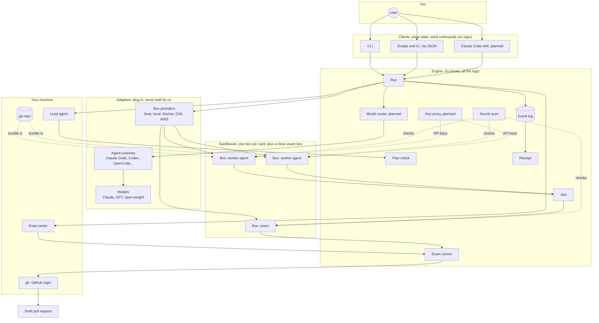
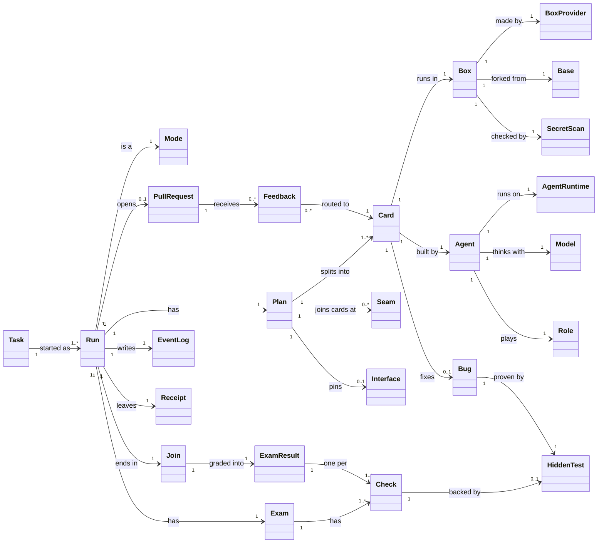
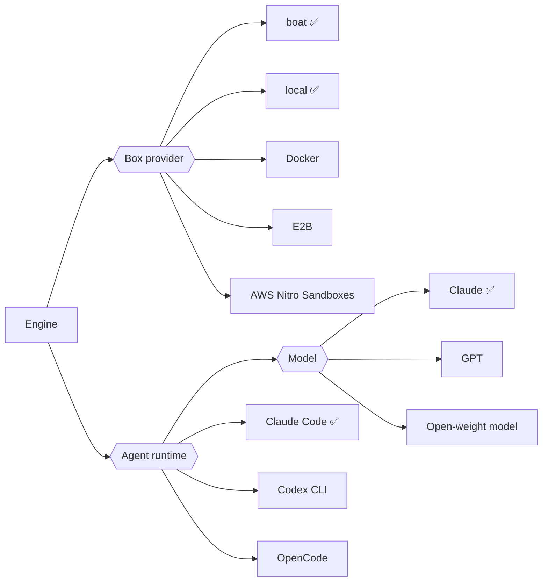
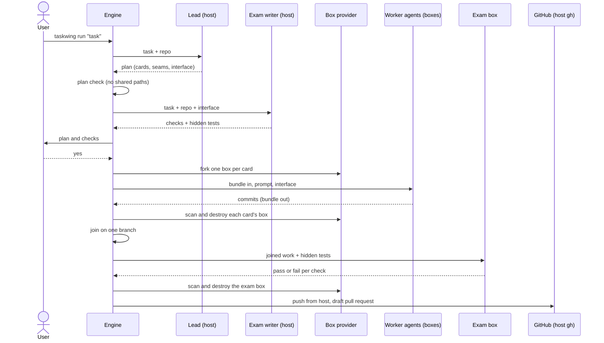

# TaskWing architecture

The source of truth for what TaskWing is made of. It names every concept, how the concepts connect, and which part of the system owns each one. `FEATURES.md` lists what is built and what is planned, by the same names.

Rules for this file:

| Rule | What breaks without it |
|---|---|
| A change that adds, renames or removes a concept updates this file in the same pull request | The map and the code drift apart, and the map stops being worth reading |
| Every concept has one name, used the same way in code, docs and CLI | Two words for one thing, or one word for two things |
| A concept that is not built yet stays here, marked *planned* | Plans live only in someone's head |

Status marks: **built** (in the code now), **partial** (in the code, but not all of what is described), **planned** (not in the code yet).

## The whole system on one page

## Ontology: the concepts and how they connect

### Work

| Concept | What it is | Owned by | Status |
|---|---|---|---|
| Task | The user's goal for one repository, in plain words | User | built |
| Run | One attempt at a task, from plan to pull request | Engine | built |
| Run id | Names a run, its branch, refs and folder: `tw-YYYYMMDD-HHMMSS-xxxx` (date, time, 4 hex, so two runs in one second differ) | Engine | built |
| Stage | Where a run is: `planning`, `approve`, `build`, `exam`, `pr`, `done`. The board shows them as 1/4 to 4/4; the JSON stream sends `run.stage` | Engine | built |
| Mode | What kind of run: *build* (`taskwing run`) or *hunt* (`taskwing hunt`) | Engine | built |
| Plan | The lead's split of the task: cards, seams, interface (`plan.json`) | Lead writes, engine checks | built |
| Card | One piece of the plan: an id, a title, the files it owns, a prompt, where to look and why | Plan | built |
| Owns | The paths a card should change. Two cards never own the same path, or their work conflicts at join. A change outside a card's paths is flagged in the run and the pull request, not refused | Plan check | built |
| Seam | A contract between two cards (for example "dates in UTC"), owned by one of them | Plan | built |
| Interface | The public names the lead pins before anyone builds: routes, JSON fields, env vars. The exam and every worker get it | Plan | built |
| Bug | In hunt mode: a suspected defect with a test that fails on today's code | Hunter | built |
| Join | All cards' commits merged on one branch, `taskwing/<run id>` | Engine | built |
| Agent ref | Each agent's commits on the host, `refs/taskwing/<run id>/<card id>`, before the join. `taskwing doctor --clean` deletes leftovers | Engine | built |
| Left-out card | A card whose commits conflict with the others at join. It is dropped from the branch and shown as stuck (planned: the lead resolves the conflict) | Engine | built |
| Pull request | One draft pull request with proof and exam results. Never merged by TaskWing, so no unreviewed work lands | Engine, through the host's `gh` | built |
| Feedback | CI failures and reviews on the pull request, sent back to the card that owns the files. Only from writers GitHub confirms and exact bot logins | Engine | planned |

### Proof

| Concept | What it is | Owned by | Status |
|---|---|---|---|
| Exam | What "done" means for a run: checks plus hidden tests | Exam writer, then the user | built |
| Check | One plain sentence the user approves, for example "a retry after a 500 returns 200" | Exam | built |
| Hidden test | The code behind a check. Lives only on the host and in the exam box; no worker or lead sees it | Exam | built |
| Exam approval | The user says yes to the checks before any agent starts. At the prompt: `y` start, `n` stop, `r` new plan, or a sentence that becomes the user's own check | User | built |
| User check | A check the user types at approval. A separate exam session writes its hidden tests while the agents build; the builders never see them | User, exam writer | built |
| Exam now | During the build the user asks for the exam early (`e` + Enter, or `exam.now`); agents stop and what they have is joined | User | built |
| Exam result | Pass or fail per check, on the joined work, in a clean box | Exam runner | built |
| Ruling | After a failure: the lead decides whether the work or the check was wrong; only the user changes a check | Lead, user | planned |
| Proof | What each card shows as evidence (a page, a request, a test, a file), shown as one line on the board | Agent, CLI | partial (one text line per card) |
| Receipt | What a run leaves behind for review and slides: time, cost, models used, checks passed, pull request link, a replay | Engine | partial (events, logs, PR body; no cost, models or replay) |

### Agents

| Concept | What it is | Owned by | Status |
|---|---|---|---|
| Agent | One coding agent session working on one job | Agent runtime | built |
| Role | What an agent is for. Lead: plans, on the host. Exam writer: writes the exam, on the host, separate session. Worker: builds one card, in a box. Hunter: finds and proves bugs. Fixer: a worker that gets a bug but not its test | Engine | built |
| Agent runtime | The CLI that runs an agent: Claude Code today; Codex, OpenCode and other boat harnesses through `--agent`; Gemini CLI later. Spoken to through ACP where possible | Adapter | partial (Claude Code proven; others through boat, not yet proven live) |
| Model | The model an agent thinks with: Claude today; GPT and an open-weight model next | Agent runtime | partial (Claude only) |
| Model router | Picks the runtime and model per role and per card: a cheap open model for routine work, a frontier model for hard work. The engine picks; it never calls a model itself | Engine | planned |
| Login | How an agent signs in to its model. A subscription login goes through the box provider; an API key goes through the key proxy | Box provider, key proxy | partial (subscription through boat only) |

### Sandboxes

| Concept | What it is | Owned by | Status |
|---|---|---|---|
| Box | One sandbox. One per card, plus one clean box for the exam | Box provider | built |
| Repo cache | A GitHub `owner/name` given to the JSON stream is cloned once into `~/.taskwing/repos/owner/name` and reset before each run; one run at a time | Engine | built |
| Box provider | The adapter that makes boxes. Target: only create, exec, copy, list, destroy; anything else is an optional capability. Today it also starts the agent, and code moves as git bundles over exec (no copy verb yet) | Adapter | partial (boat and local only) |
| Base | What every box starts from: a boat base box today, an OCI image later. Holds the repository's toolchain and the agents' own login (on boat, through its environment), and no other secret | User, `taskwing setup` | partial (made by hand) |
| Bundle | How code moves: a git bundle into each box, a bundle of commits back out. Works over plain exec | Engine | built |
| Secret scan | Before an agent starts, look for credentials in the box (GitHub tokens, SSH keys); refuse a box that holds GitHub credentials; list every leak at the end | Engine | partial (the exam box is not checked before the joined work runs in it; at the end a scan that cannot run is skipped without a warning) |
| Key proxy | Outside the box: gives agents a placeholder key and a base URL, swaps in the real API key | Engine | planned |

### Record

| Concept | What it is | Owned by | Status |
|---|---|---|---|
| Event log | Append-only `~/.taskwing/runs/<id>/events.jsonl`. Every dispatch is written before it is sent | Engine | partial (written after each step happens, not before it is sent; not yet used to resume) |
| Decision | Something an agent decided and says afterwards (Decided, Fixed, Planned, You, Done), with change and undo | Engine, CLI | planned |
| Resume | After a crash the engine rebuilds a run from boxes, git refs, GitHub and the event log | Engine | planned |
| Doctor | Finds and cleans boxes and refs a run left behind; never touches the base, or every later run loses the box it forks from | CLI (`cmd/taskwing`) | built |

### Settings

| Concept | What it is | Owned by | Status |
|---|---|---|---|
| Home | `~/.taskwing`, or `TASKWING_HOME`: config, runs, repo cache, local boxes | CLI | built |
| Config | `~/.taskwing/config.json`, today only `boat_base`, set with `taskwing config boat-base <id>`. Environment variables win over it | CLI | built |

## Parts of the system

| Part | Does | Never does | What breaks without it | Status |
|---|---|---|---|---|
| Engine | All the logic: runs, plan check, boxes, bundles, exam, join, push, scan, event log | Call a model itself, hold a subscription login | Model code ties the engine to one vendor; holding a subscription login breaks the provider's terms (`PRINCIPLES.md` #3) | built |
| CLI | Every engine action as a command | Anything the engine can't do | Logic outside the engine, so runs can't be scripted (`PRINCIPLES.md` #11) | partial: `run`, `hunt`, `config`, `doctor`, `engine`, `version`, `help` |
| Engine stream | Newline-delimited JSON: events out, commands in (`taskwing engine --json`, `docs/engine-protocol.md`) for scripts, CI and editors; the CLI draws its own board from the same run | | | built: no pause, agent questions or notes yet |
| Board | The CLI's live view: one line per agent with a glyph (■ grey done, ▣ blue working, □ waiting, ✗ red stuck; amber "needs you" planned) and a short proof line, redrawn in place on a terminal, one line per state change when piped | Hold state of its own; it draws the run | Paragraphs per agent nobody reads (`AGENTS.md`, Pictures over text) | built (`internal/engine/ui.go`) |
| Skill | A Claude Code skill: installs TaskWing, starts a run from a chat, fixes setup | Run agents itself | Agents the engine can't see, scan or clean up | planned |

## Adapters

| Adapter | Option | Status | Note |
|---|---|---|---|
| Box provider | boat | built | Default. Use a boat environment that carries only the agent login |
| Box provider | local | built | Folders on the host, no isolation. For trying the flow and for tests |
| Box provider | Docker | planned | Free local backend |
| Box provider | E2B | planned | Promised in the ContainerDays abstract |
| Box provider | AWS | planned | Promised in the abstract. AWS Nitro Sandboxes (hardware-isolated EKS pods, ECS tasks, EC2) or Lambda MicroVMs; pick one by a spike |
| Agent runtime | Claude Code | built | Through `boat prompt` in boxes and `claude -p` on the host |
| Agent runtime | Codex CLI, OpenCode, pi, prime, Kimi, Mistral | partial | Through `boat prompt --provider` in boxes (`--agent`); not yet proven in a live run. OpenCode can drive open-weight models |
| Model | Claude | built | |
| Model | GPT, an open-weight model | planned | At least one non-Claude model must work in a live run by 10 Feb 2027 |

A model is not a third adapter: the agent runtime runs it, and the router picks which runtime and model a role or card gets. This keeps `PRINCIPLES.md` #1 (only Box and Agent adapters).

Today the box provider also starts the agent (`box.Provider.StartAgent`), and code moves as git bundles over exec. The target splits these: a box provider only makes boxes, and an agent runtime runs in any box (`PRINCIPLES.md` #1). That split is the first step towards a second runtime.

### Planned refactors

| Refactor | Why | What breaks without it |
|---|---|---|
| One engine event model and an asker interface, shared by the terminal board and the JSON stream | Today each has its own code for approval, new plan and exam now | The two front ends drift; a fix in one misses the other |
| Split Box and Agent adapters, add a Copy verb and declared capabilities, before Docker, E2B or AWS Nitro | Today the box provider starts the agent and code moves only as bundles over exec | Every new provider copies boat's agent quirks; a second runtime needs every provider changed |

## One build run, step by step

Hunt mode swaps the first three steps: a hunter writes one failing test per suspected bug, the engine keeps only tests that fail on today's code, and each bug becomes a card whose test becomes a check.

## Trust boundaries

| Boundary | Rule | What breaks without it |
|---|---|---|
| Host to box | Code goes in as a bundle. No GitHub login, no API key, no `.env` | An agent pushes as the user or copies their keys |
| Box to host | Only commits come back; host git runs with hooks off when it handles them | A worker's repo runs code on the host |
| Local mode | Agents run on the host with GitHub and SSH tokens removed from their environment. Not a sandbox | Nothing: it is for trying the flow, and docs and clients must say so |
| Lead and exam writer | `plan.json` is saved only after the exam is written; a new plan deletes the old exam first | One session reads the other's output and the exam stops being independent |
| Exam | Hidden tests stay on the host and in the exam box | Workers edit the tests until they pass |
| Pull request | Only trusted feedback reaches an agent | Prompt injection through comments |

## Open decisions

Decisions already made live in the Decisions table in `AGENTS.md`.

| Decision | Options | Leaning |
|---|---|---|
| AWS sandbox product | Nitro Sandboxes on EKS/ECS/EC2, or Lambda MicroVMs | Spike both for start time and cost |
| Second agent runtime | Codex CLI, OpenCode, Gemini CLI | OpenCode: one runtime for several model vendors and open-weight models |
| Agent protocol | ACP everywhere, or each CLI's own JSON stream | ACP where the runtime supports it |
| Engine stream transport | stdio JSON, embedded NATS | stdio first; NATS as wiring later |
