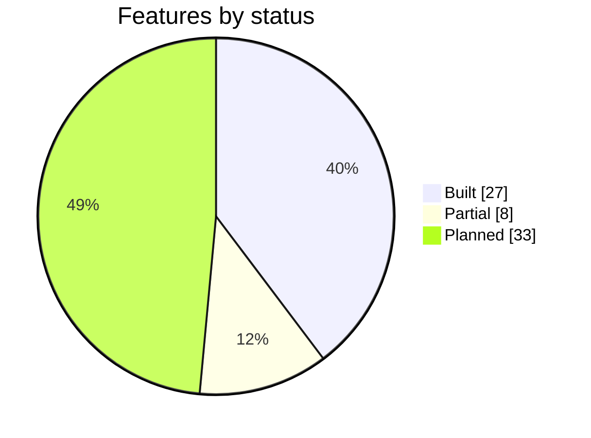
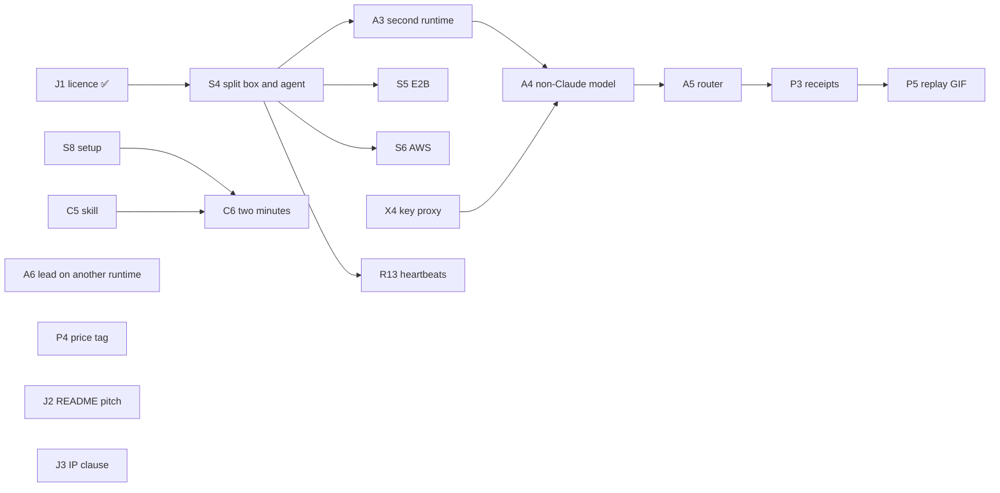

# TaskWing features

Every feature TaskWing has or will have, with its status. The concepts are defined in `ARCHITECTURE.md`; this list uses the same names.

| Rule | What breaks without it |
|---|---|
| A pull request that builds a feature, or part of one, changes its status here in the same pull request | Nobody can tell what is real without reading the code |
| A new idea goes in as *planned* with a milestone, before anyone builds it | Work starts that nobody agreed to |
| A feature marked 🎤 is promised in a talk; it must be **built** before the talk date | A claim on stage that a live demo disproves |

Status: ✅ built · 🟡 partial · ⬜ planned. Milestones: **PoC** (done, Nov 2026) · **M1** (first real milestone, `SPEC.md`) · **Talk** (ContainerDays / AI Context London, 10-11 Feb 2027) · **Later**.

## Progress

## Run

| ID | Feature | Status | Milestone | Note |
|---|---|---|---|---|
| R1 | `taskwing run "<task>"`: one task to one draft pull request | ✅ | PoC | |
| R2 | Lead agent plans and splits the task into cards | ✅ | PoC | `claude -p` on the host |
| R3 | Plan check: no two cards own the same path; seams have owners; ids are safe | ✅ | PoC | |
| R4 | Pinned interface: the lead names routes, fields and env vars before anyone builds | ✅ | PoC | 🎤 Added after the Osprey feature run |
| R5 | One agent per card, in parallel, each in its own box | ✅ | PoC | |
| R6 | Join every card's commits on one branch | ✅ | PoC | |
| R7 | Push from the host and open a draft pull request with proof and exam results | ✅ | PoC | |
| R8 | Live squares in the terminal, one per agent | ✅ | PoC | |
| R9 | Lead resolves conflicts at join | ⬜ | M1 | Today a conflict drops the card |
| R10 | Resume a run after a crash, with no duplicate boxes | ⬜ | M1 | From boxes, git refs, GitHub and the event log |
| R11 | Trusted feedback: CI failures and reviews go back to the card that owns the files | ⬜ | Later | Only confirmed writers and exact bot logins |
| R12 | Agents pass notes to each other across a seam | ⬜ | Later | |
| R13 | Heartbeats: every box reports in; a box that goes quiet is marked stuck | ⬜ | Talk | 🎤 Go fan-out with heartbeats and one event log |

## Hunt

| ID | Feature | Status | Milestone | Note |
|---|---|---|---|---|
| H1 | `taskwing hunt [area]`: find bugs, prove each with a failing test | ✅ | PoC | 🎤 4 of 4 real bugs on Osprey, 9 minutes |
| H2 | Keep only tests that fail on today's code | ✅ | PoC | |
| H3 | Fixers get the bug but not its test | ✅ | PoC | |
| H4 | One pull request with a bugs table | ✅ | PoC | |
| H5 | Hunt on today's main and skip bugs already fixed or in open pull requests | ⬜ | M1 | 2 of 4 Osprey finds were already fixed on main |
| H6 | Run the "existing tests still pass" check without the hidden bug tests | ⬜ | M1 | Today one stuck fixer looks like a broken old test |
| H7 | Flag fixes that touch scoring, public API or migrations for review | ⬜ | Later | |

## Exam

| ID | Feature | Status | Milestone | Note |
|---|---|---|---|---|
| E1 | A separate session writes the exam: checks plus hidden tests | ✅ | PoC | |
| E2 | Hidden tests never reach a worker or the lead | ✅ | PoC | |
| E3 | The exam runs in a clean box on the joined work | ✅ | PoC | |
| E4 | User approves the exam before any agent starts | 🟡 | PoC | A y/N prompt; `--yes` skips it |
| E5 | User adds a check; the exam writer turns it into a test | ⬜ | M1 | |
| E6 | Ruling after a failure: the work or the check was wrong | ⬜ | M1 | Only the user changes a check |
| E7 | The exam writer explains a failure in plain words | ⬜ | M1 | |

## Sandboxes

| ID | Feature | Status | Milestone | Note |
|---|---|---|---|---|
| S1 | boat box provider | ✅ | PoC | 🎤 |
| S2 | Local provider (folders, no isolation) | ✅ | PoC | For trying the flow and tests |
| S3 | Code moves in and out as git bundles over plain exec | ✅ | PoC | Works on any provider with exec |
| S4 | Box provider and agent runtime are separate adapters | ⬜ | Talk | Today the provider also starts the agent; needed before S5-S7 and A3 |
| S5 | E2B box provider | ⬜ | Talk | 🎤 |
| S6 | AWS box provider | ⬜ | Talk | 🎤 Nitro Sandboxes or Lambda MicroVMs; spike first |
| S7 | Docker box provider | ⬜ | Later | Free local backend |
| S8 | `taskwing setup`: make the base (environment, toolchain) for a repository | ⬜ | M1 | First setup took about an hour by hand |
| S9 | `taskwing doctor`: find and clean leftover boxes and refs, never the base | ✅ | PoC | |

## Agents and models

| ID | Feature | Status | Milestone | Note |
|---|---|---|---|---|
| A1 | Claude Code as the agent runtime | ✅ | PoC | |
| A2 | Model and effort per run (`--model`, `--effort`) | ✅ | PoC | boat only |
| A3 | A second agent runtime (OpenCode or Codex CLI) | ⬜ | Talk | 🎤 |
| A4 | A non-Claude model working in a live run, ideally open-weight | ⬜ | Talk | 🎤 "Any model" |
| A5 | Model router: pick runtime and model per role and per card | ⬜ | Talk | 🎤 Frontier models plan, open-weight models do routine work. Routing, not "open beats closed" |
| A6 | Lead and exam writer can use a different runtime than Claude | 🟡 | Talk | `TASKWING_LEAD_CMD` and `TASKWING_EXAM_CMD` take any command today |
| A7 | Speak ACP to runtimes that support it | ⬜ | Later | |

## Safety

| ID | Feature | Status | Milestone | Note |
|---|---|---|---|---|
| X1 | Refuse a box that holds GitHub credentials | 🟡 | PoC | Card boxes only; the exam box, where the joined work runs, is not checked. A scan that cannot run also refuses |
| X2 | Secret scan of every box before it is destroyed | 🟡 | PoC | The agents' own login is named as expected. A scan that cannot run is skipped without a warning, and the PR body still says nothing was found (also in local mode, where no scan runs) |
| X3 | Host pushes; no box ever gets a GitHub login | ✅ | PoC | |
| X4 | Key proxy: placeholder key in the box, real API key swapped in outside | ⬜ | Talk | Needed for API-key models (A4) |
| X5 | Read worker commits with git hooks and fsmonitor off | ⬜ | M1 | The PoC fetches bundles with default git settings |

## Record and proof

| ID | Feature | Status | Milestone | Note |
|---|---|---|---|---|
| P1 | Event log per run (`events.jsonl`) | 🟡 | PoC | 🎤 Written after each step, not before dispatch; not used to resume yet |
| P2 | Every agent's full log saved with the run | ✅ | PoC | |
| P3 | Receipt per run: time, cost, models, checks, pull request link | 🟡 | Talk | 🎤 Time and checks today; cost and models missing |
| P4 | Price tag before you say yes | ⬜ | Talk | Joseph's pick |
| P5 | 30-second replay of a run as a GIF | ⬜ | Talk | Joseph's pick, for slides |
| P6 | Click a proof to see it live (preview of the running app) | ⬜ | Later | Joseph's pick; needs a preview port per box |
| P7 | Decisions log with change and undo | ⬜ | Later | |

## Clients

| ID | Feature | Status | Milestone | Note |
|---|---|---|---|---|
| C1 | CLI: `run`, `hunt`, `config`, `doctor`, `version` | ✅ | PoC | |
| C2 | CLI: `status`, `exam`, `answer`, `attach`, `stop` | ⬜ | M1 | |
| C3 | `taskwing config boat-base` saves the base box | ✅ | PoC | |
| C4 | Engine stream: JSON events out, commands in | ✅ | M1 | `taskwing engine --json` (`internal/engine/stream.go`). For scripts, CI and editors (`docs/engine-protocol.md`). Not yet: pausing agents, agent questions, notes between agents |
| C5 | Start from a Claude Code skill | ⬜ | Talk | Joseph's pick |
| C6 | Two minutes from install to the first agent | ⬜ | Talk | Joseph's pick; depends on S8 and C5 |
| C7 | ~~Cockpit desktop app~~ | — | — | Dropped 2026-11-22: TaskWing is terminal only. The Tauri app stays in git history (last on main at e6f117d); the board (R8) shows the run |
| C8 | Install the CLI with Homebrew, Linux packages, archives or `go install` | 🟡 | M1 | GoReleaser on `vX.Y.Z` tags. No v2 release yet, so Homebrew still installs v1.23.2 |

## Project

| ID | Feature | Status | Milestone | Note |
|---|---|---|---|---|
| J1 | Open source licence: AGPL-3.0 with a NOTICE file | ✅ | Talk | 🎤 ContainerDays accepts only open source |
| J2 | README and docs use the approved pitch word for word, and never state a fixed agent count | ⬜ | Talk | |
| J3 | Check the employer's IP clause before company use | ⬜ | Talk | |
| J4 | Trademark the TaskWing name | ⬜ | Later | |
| J5 | Check the subscription terms for running many headless Claude Code agents | ⬜ | Talk | Unchecked |

## What the talk needs, in order

